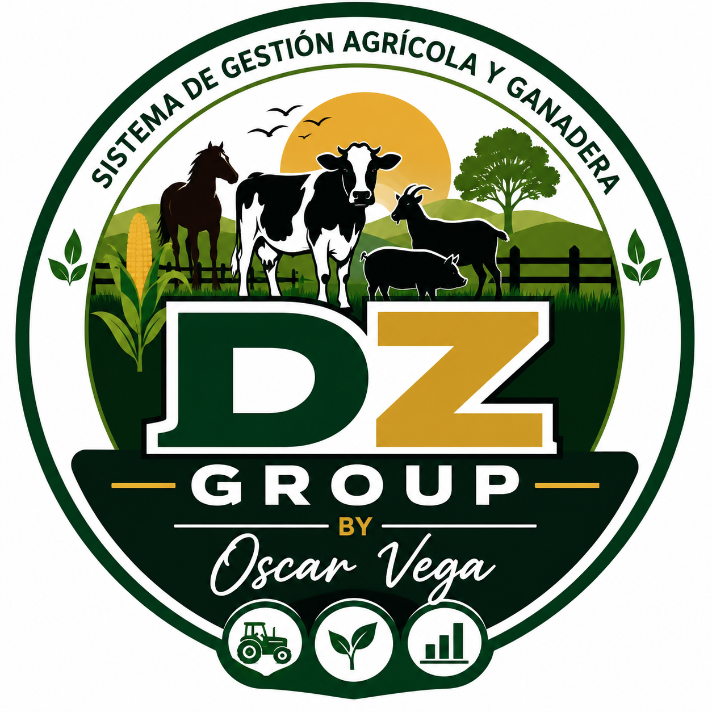

# Manual de usuario de FincaControl

- **Versión:** 2.1.2
- **Actualizado:** 9 de noviembre de 2026
- **Creador y desarrollador:** Oscar David Vega Daza

## 1. Propósito

FincaControl es un sistema para organizar la información y las actividades de una finca agrícola y ganadera. Reúne en un mismo lugar los registros del ganado, la producción, los inventarios, los cultivos, las labores y los reportes. Su propósito es facilitar el seguimiento diario y que las personas autorizadas consulten información consistente de su finca.

El sistema admite trabajo conectado y, para las operaciones compatibles, trabajo temporal sin conexión con sincronización posterior.

## 2. Creador

**Oscar David Vega Daza** — Creador y desarrollador del software.

Para soporte, consultas o reportes de errores, escriba a **enterprisesystemsvegadaza@gmail.com** e incluya **“Sistema Ganaderia”** en el asunto.

## 3. Requisitos

### Compatibilidad por sistema operativo

FincaControl se puede usar en:

- **Windows 10 y Windows 11 de 64 bits:** como aplicación de escritorio, usando el instalador `FincaControl Setup 2.1.2.exe` o el portable `FincaControl 2.1.2.exe`.

### Requisitos para usar la aplicación de escritorio

- Un equipo con **Windows 10 u 11 de 64 bits** para usar la aplicación de escritorio.
- El instalador de FincaControl o el ejecutable portable compatible con Windows.
- Una cuenta activa creada por el administrador de la finca.
- Conexión a Internet y acceso al servicio de FincaControl para iniciar sesión por primera vez en ese equipo, cargar información actualizada y sincronizar cambios.
- La dirección del servicio incluida en el instalador debe ser accesible desde el equipo. `localhost` y `127.0.0.1` apuntan al propio equipo y no sirven para conectar a un servidor instalado en otro computador.
- Espacio disponible para la aplicación y sus datos locales. El proyecto no establece un mínimo oficial de memoria, procesador o almacenamiento.

### Para trabajar sin conexión

- Haber iniciado sesión correctamente en ese dispositivo cuando había conexión.
- Haber descargado previamente la copia offline de la finca.
- Volver a conectarse para enviar los cambios pendientes al servidor.

En un equipo nuevo no es necesario haber iniciado sesión antes: el primer acceso se realiza en línea con una cuenta activa y con el servicio de FincaControl accesible. El inicio de sesión offline solo está disponible después de autenticar esa cuenta en el mismo equipo y preparar una copia local.

El modo offline no reemplaza la base de datos del servidor ni permite que otros dispositivos vean inmediatamente los cambios locales. Algunas acciones administrativas requieren conexión.

### Requisitos para la instalación técnica del servicio

La aplicación de escritorio se conecta a un servicio API Django y a una base de datos PostgreSQL. La instalación o administración de esos servicios debe realizarla la persona responsable del sistema; no es necesario instalar Python, Django o PostgreSQL en cada equipo de usuario si el servidor ya está disponible. El hecho de que el backend pueda instalarse en un servidor Linux no significa que el `.exe` de escritorio pueda ejecutarse allí.

## 4. Iniciar sesión y conocer la interfaz

1. Abra FincaControl.
2. Escriba el correo o nombre de usuario y la contraseña asignados.
3. Seleccione **Ingresar**.
4. Si su cuenta tiene acceso a más de una finca, confirme que está trabajando con la finca correspondiente. Los datos se muestran según la finca activa y los permisos de su cuenta.
5. Use el menú lateral o los accesos de **Inicio** para abrir los módulos disponibles.

La opción **Cerrar sesión** termina la sesión actual. En un dispositivo sin conexión, el acceso offline depende de que esa cuenta ya se haya autenticado allí previamente.

## 5. Perfiles y permisos

### Administrador

Puede acceder, según la configuración de su cuenta, a la administración de fincas, usuarios y permisos, a los reportes y a los módulos de operación. Es responsable de mantener los accesos y la configuración de la finca.

### Trabajador

Ve los módulos habilitados para su perfil. Su acceso incluye la pantalla **Carga de datos** para registrar actividades o novedades de campo. No ve las opciones administrativas reservadas al administrador.

Los nombres y módulos visibles pueden variar según los permisos y la configuración de cada finca.

## 6. Módulos disponibles

| Módulo | Uso principal |
|---|---|
| **Inicio** | Consultar un resumen de la finca y acceder rápidamente a funciones habilitadas. |
| **Animales** | Registrar, buscar, consultar y mantener fichas de animales, sus categorías y datos identificativos. La chapeta ICA debe ser única; el sistema avisa si ya está registrada. |
| **Producción de Leche** | Registrar y consultar ordeños y cantidades producidas. Se debe elegir un animal que corresponda a la producción lechera de la finca. |
| **Vacunas** | Registrar aplicaciones y su información sanitaria. El nombre de la vacuna se elige de las vacunas ya registradas o se ingresa como una nueva; el medicamento asociado se selecciona por separado del inventario. |
| **Medicamentos** | Consultar y mantener los medicamentos y sus existencias en el inventario de la finca. |
| **Insumos** | Llevar registros de insumos, cantidades, unidades, compras y observaciones. |
| **Equipos** | Mantener el inventario y el estado de los equipos. |
| **Cultivos** | Registrar y consultar cultivos y su estado. |
| **Piscicultura** | Registrar y consultar información de la actividad piscícola. |
| **Actividades** | Registrar y revisar labores, eventos y novedades de la finca. |
| **Enfermedades** | Crear y consultar reportes de enfermedad, síntomas y animal relacionado cuando corresponda. |
| **Reportes** | Consultar indicadores y resúmenes de los datos registrados, según los permisos. |
| **Usuarios** | Administrar cuentas de usuario y sus accesos, para perfiles autorizados. |
| **Fincas** | Consultar o administrar las fincas disponibles, según el perfil. |
| **Configuración** | Ajustar opciones de la finca y de la aplicación, según el perfil. |
| **Ayuda e Información** | Consultar información del creador, licencia y soporte. |

### Descargar un reporte

En **Reportes**, elija **Descargar Excel** para obtener un archivo `.xlsx` con un resumen y hojas de registros completos. Elija **Descargar reporte** para generar un documento Word con portada FincaControl, índice actualizable y los datos de la finca ordenados por secciones. El registro de animales incluye una ficha titulada para cada ejemplar, agrupada por especie y categoría; también se incluyen la producción de leche, vacunas, inventarios, cultivos, piscicultura, actividades y enfermedades. Los reportes usan los registros completos de la finca activa disponibles en el servicio o en la copia offline.

## 7. Flujo de trabajo recomendado

1. **Revise la finca activa y la conexión.** Antes de registrar datos, compruebe el nombre de la finca y el indicador de conexión.
2. **Prepare los datos base.** El administrador crea las cuentas necesarias y configura permisos. Mantenga actualizados los catálogos y existencias que se usarán en los registros.
3. **Registre cada dato en su módulo.** Use Animales para las fichas; Producción de Leche para los ordeños; Vacunas para aplicaciones; Medicamentos e Insumos para inventarios; y Actividades o Enfermedades para novedades de campo.
4. **Busque antes de crear duplicados.** En especial, verifique la chapeta ICA y revise los registros existentes antes de crear un animal.
5. **Complete y revise el formulario.** Seleccione las opciones correctas, ingrese cantidades y fechas, y agregue observaciones útiles, como el nombre conocido del animal.
6. **Guarde y confirme el resultado.** Si hay conexión, compruebe el mensaje de confirmación. Sin conexión, compruebe que el cambio aparezca en la cola pendiente del panel de conexión.
7. **Revise reportes y pendientes.** El administrador puede consultar reportes y revisar los datos cargados por trabajadores después de su sincronización.

## 8. Búsqueda y datos de animales

- Use el buscador del módulo o del selector de animales para filtrar los registros disponibles.
- Identifique al animal con su nombre o apodo y los datos que la finca utilice. Las observaciones pueden ayudar a reconocerlo.
- La chapeta ICA identifica al animal y no se debe reutilizar. Si el sistema indica que ya existe, busque el animal registrado y revise o corrija el dato antes de volver a guardar.
- En vacunas y otros registros relacionados, seleccione el animal por su descripción reconocible; no dependa únicamente de la chapeta.
- Mantenga las categorías y los datos productivos correctos. Por ejemplo, el estado reproductivo debe describir al animal y la producción de leche debe asociarse a hembras que correspondan a los criterios productivos configurados en la finca.

## 9. Vacunas y medicamentos

Vacuna y medicamento son datos distintos:

- **Vacuna:** el producto o tipo de vacuna aplicado. Se puede seleccionar un nombre usado previamente o registrar uno nuevo.
- **Medicamento:** un producto del inventario de medicamentos de la finca, que se vincula de forma independiente cuando corresponda.

Si un registro anterior no aparece asociado a un medicamento, puede conservar el texto histórico sin que eso signifique que el inventario haya sido descontado o actualizado. Verifique las existencias en el módulo de Medicamentos.

## 10. Conexión, modo offline y sincronización

El panel **Conexión** muestra si el equipo está en línea o sin conexión y permite revisar los cambios pendientes.

### Preparar una copia offline antes de quedarse sin Internet

1. Conéctese a Internet e inicie sesión en el dispositivo.
2. Abra el panel **Conexión** y seleccione **Crear copia offline**.
3. Espere el aviso **“Copia offline creada correctamente”** antes de desconectarse.

La copia se guarda en el almacenamiento local de la aplicación para la finca activa. No es necesario ni posible elegir una carpeta para esta copia de trabajo. Se conserva al cerrar sesión, cerrar el programa o apagar el equipo, pero no está protegida contra borrar los datos de la aplicación, fallos del disco o pérdida del dispositivo. Para actualizarla, vuelva a conectarse y cree una nueva copia o use **Sincronizar ahora**.

### Cuando hay conexión

- Los cambios se envían al servicio de la finca.
- Use **Sincronizar ahora** si necesita solicitar una sincronización manual.
- Espere la confirmación antes de cerrar la aplicación o dar por compartido un registro.

### Cuando no hay conexión

- Las operaciones compatibles se guardan en el almacenamiento local de ese dispositivo y se agregan a una cola.
- Puede activar **Activar modo offline** para trabajar deliberadamente sin enviar cambios durante ese momento.
- Los cambios locales todavía no están en la base de datos del servidor y no son visibles para otros usuarios o dispositivos.
- Al recuperar la conexión, seleccione **Reanudar conexión** o **Sincronizar ahora** y revise el resultado.

### Conflictos o cambios rechazados

Si el mismo dato cambió en el servidor o el servidor rechaza una operación, el panel lo muestra para que pueda revisarlo. Según el caso, las opciones pueden incluir conservar el cambio local, usar el del servidor, editar el dato o eliminar la operación. Revise cuidadosamente antes de descartar o reemplazar información; una operación eliminada no se enviará.

> **Importante:** no borre los datos del navegador o de la aplicación, no reinstale y no cambie de dispositivo mientras existan cambios pendientes. Podría perder la copia local que aún no se ha sincronizado. Confirme que la cola esté vacía y que la aplicación indique sincronización completada.

## 11. Buenas prácticas

- No comparta su contraseña. Solicite al administrador una cuenta propia.
- Verifique la finca y el animal antes de guardar cada registro.
- Ingrese fechas y cantidades reales, usando las unidades indicadas.
- Use las observaciones para anotar contexto útil y evitar confundir animales con nombres similares.
- No cree otra ficha para corregir una existente; busque y edite la ficha correcta.
- Revise el indicador de conexión y los cambios pendientes antes de cerrar sesión o apagar el equipo.
- Mantenga el sistema y el sistema operativo actualizados.
- En caso de error, anote el módulo, la operación realizada y el texto del mensaje. No envíe contraseñas ni datos sensibles al soporte.

## 12. Solución de problemas

| Situación | Qué hacer |
|---|---|
| No puede iniciar sesión | Compruebe el usuario y la contraseña, la conexión y que la cuenta esté activa. Si está offline, la cuenta debe haberse autenticado previamente en ese dispositivo. |
| No aparece una finca o módulo | Confirme la finca activa y solicite al administrador que revise su asociación y permisos. |
| La chapeta ICA ya existe | Busque la chapeta en Animales. Corrija la ficha existente o confirme que se trata de un animal distinto antes de usar otro identificador válido. |
| Un cambio no aparece en otros equipos | Revise el panel de Conexión. Si está pendiente, recupere Internet y sincronice. |
| Aparece un conflicto | Compare los datos disponibles y elija conscientemente qué versión conservar. Si no está seguro, no descarte la operación y consulte al administrador. |
| No encuentra un animal en una lista | Busque por nombre o apodo y revise las observaciones. Compruebe también que esté en la finca activa y cumpla los criterios del registro. |
| La aplicación presenta un error | Anote el mensaje y los pasos que lo produjeron; contacte al soporte incluyendo “Sistema Ganaderia” en el asunto. |

## 13. Información y propiedad

FincaControl es software de propiedad de **Oscar David Vega Daza**. El uso del software está sujeto a la licencia otorgada para la finca autorizada. Consulte **Ayuda e Información** en la aplicación para conocer las condiciones de uso y propiedad intelectual.
